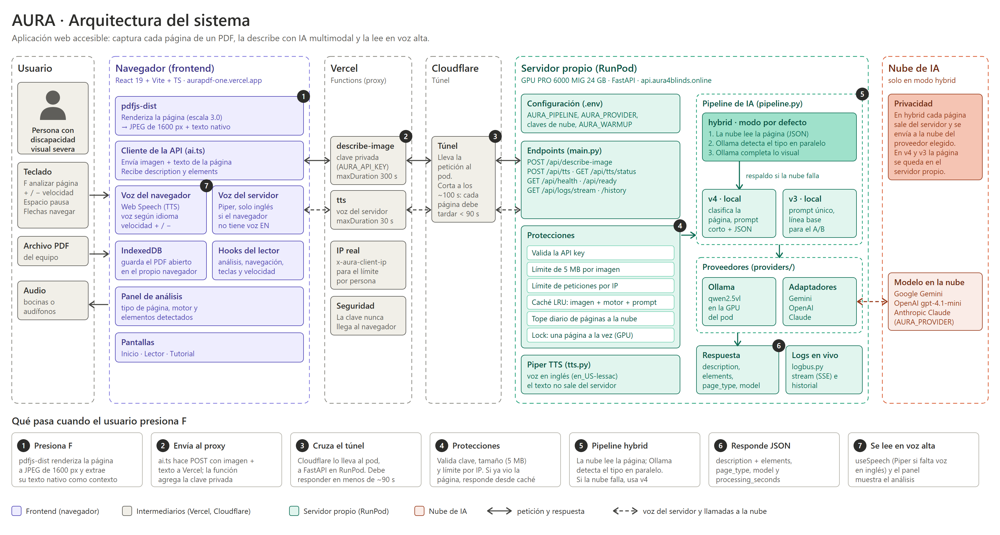

# Guía de capturas para el manual de administrador de AURA

Cómo montar y operar AURA en línea desde cero: GitHub, Vercel, claves, dominio, Cloudflare y el servidor con GPU en RunPod.

*Versión del 9 de octubre de 2026. 30 pasos y 47 capturas.*

## Cómo usar este documento

- **Rodrigo:** Sigue los pasos en orden. En cada uno toma las capturas que se piden, guárdalas con el nombre indicado y márcalas como listas en la lista maestra del final. Después manda a Victoria este documento y las capturas.
- **Victoria:** Con el texto de cada paso y sus capturas redacta el manual. No necesitas ejecutar nada: si algo no queda claro, pregunta a Rodrigo antes de suponerlo.

### Mensaje listo para mandar a Victoria

> Hola Victoria. Te paso la guía paso a paso de AURA en línea. Con ella necesito que armes el Manual de administrador: cómo montar todo desde cero (GitHub, Vercel, claves, dominio, Cloudflare y el servidor con GPU en RunPod) y cómo operarlo (encender, comprobar, apagar, cambiar claves y resolver fallas).
>
> Cada paso trae: el objetivo, qué hacer, los comandos, cómo saber que salió bien y los avisos. Las capturas te las mando con el nombre que indica cada paso (por ejemplo B1-1-github-nuevo-repositorio.png). Los pasos marcados «Por confirmar» los reviso yo y te aviso si cambia algo.
>
> Formato que te pido: Word o PDF con índice, la Figura 1 (arquitectura), una captura por pantalla importante, una tabla de problemas frecuentes y una lista de comprobación para cada vez que se enciende el servidor.
>
> Importante: en el manual nunca pongas claves reales. Escribe <TU_CLAVE> o <TOKEN> en su lugar.

### Reglas para tomar las capturas

1. **Nunca captures una clave, un token ni una contraseña.** Si una pantalla los muestra, tápalos con un rectángulo negro o sácalos del recuadro. Una captura con una clave visible hay que borrarla y cambiar esa clave.
1. **Tampoco captures** números de tarjeta, direcciones, teléfonos o el correo completo. Para los pagos basta con la pantalla anterior a los datos de la tarjeta.
1. Usa **Win + Shift + S** (Windows) para recortar solo la parte útil de la pantalla. Guarda en PNG.
1. Pon el navegador al **100 % de zoom** y en español o inglés, pero siempre el mismo idioma en todas las capturas.
1. Si la pantalla trae **varios datos importantes**, deja visible la barra de direcciones para que se vea en qué sitio estás.
1. Nombra cada archivo **exactamente** como indica el paso (por ejemplo `B1-1-github-nuevo-repositorio.png`). Así Victoria sabe dónde va cada una.
1. Si una pantalla es distinta a lo que dice la guía (los sitios cambian sus botones), **captura lo que ves** y avisa a Victoria; no adivines.

### Modo ensayo: no hace falta comprar ni crear nada otra vez

No hace falta comprar ni crear nada de nuevo. Casi todo ya existe. Para las pantallas de «crear» (nuevo repositorio, nuevo proyecto, comprar un dominio, crear un pod) **abre el formulario, llénalo y captúralo sin presionar el botón final**. Para las de «revisar» (variables, DNS, túnel) abre la pantalla real y tapa los valores secretos. Solo enciende el pod si de verdad vas a usarlo: cobra US$0.49 por hora.

### Cuentas y servicios que intervienen

| Servicio | Dirección | Para qué sirve | Costo |
|---|---|---|---|
| GitHub | github.com | Guarda el código | Gratis |
| Vercel | vercel.com | Publica la página y el proxy que protege la clave | Plan Hobby, gratis |
| OpenAI (plataforma de API) | platform.openai.com | Modelo de IA en la nube del modo hybrid | Unos US$0.003 por página, con saldo prepago |
| Registrador del dominio | Por confirmar con Rodrigo | Vende el dominio aura4blinds.online | US$1.18 al año (el precio actual) |
| Cloudflare | cloudflare.com | Maneja el dominio y crea el túnel hacia el servidor | Gratis |
| RunPod | runpod.io | Alquila el servidor con GPU (Ollama y la API) | US$0.49 por hora encendido, más el disco (unos US$3 al mes) |
| Gestor de contraseñas | Bitwarden, 1Password u otro | Guarda las claves; nunca en chats ni en el repositorio | Gratis o de pago |

### Figura 1. Arquitectura del sistema



Los números de la figura coinciden con los siete pasos de la franja inferior: presiona F, envía al proxy, cruza el túnel, protecciones, pipeline hybrid, responde JSON y se lee en voz alta.


---

## Parte A. Preparar la computadora

Las herramientas que se usan en los pasos siguientes. Se instalan una sola vez.


### Paso A1. Instalar Git, Node.js y Python

*Estado: Confirmado con el proyecto*

**Objetivo.** Tener los programas con los que se sube el código y se generan las claves.

**Qué hacer**

1. Instala **Git para Windows** desde git-scm.com (todas las opciones por defecto).
2. Instala **Node.js 22 LTS** desde nodejs.org.
3. Instala **Python 3.12** desde python.org y marca la casilla **Add python.exe to PATH**. Con Python 3.13 o más nuevo, la instalación del servidor suele fallar.
4. Cierra y vuelve a abrir la terminal (PowerShell) y comprueba las versiones.

PowerShell:

```
git --version
node --version
python --version
```

> **CAPTURA A1-1** — guardar como `A1-1-versiones-herramientas.png`  
> Qué debe verse: La terminal con las tres versiones.  
> Tapar: Nada que tapar.

**Cómo saber que salió bien.** Salen tres líneas con números de versión (Node 22 o más; Python 3.12).


---

## Parte B. Código en GitHub

Aquí vive el código de AURA. De este repositorio sale la página (Vercel) y el servidor (RunPod).


### Paso B1. Crear el repositorio

*Estado: Confirmado con el proyecto*

**Objetivo.** Tener un lugar en internet donde guardar el proyecto.

**Qué hacer**

1. Entra a github.com e inicia sesión (o crea una cuenta).
2. Arriba a la derecha, presiona **+** y elige **New repository**.
3. En **Repository name** escribe `tesis` (el actual es AdrianRosa21/tesis).
4. En visibilidad elige **Public** o **Private**. El actual es público.
5. **No** marques README, .gitignore ni licencia: el proyecto ya trae sus propios archivos.
6. Presiona **Create repository**.

> **CAPTURA B1-1** — guardar como `B1-1-github-nuevo-repositorio.png`  
> Qué debe verse: El formulario «Create a new repository» lleno, antes de crear.  
> Tapar: Nada.

> **CAPTURA B1-2** — guardar como `B1-2-github-repositorio-real.png`  
> Qué debe verse: La página del repositorio real: github.com/AdrianRosa21/tesis, con sus carpetas.  
> Tapar: Nada.

**Cómo saber que salió bien.** GitHub muestra la página del repositorio con las instrucciones para subir archivos.

**Cuidado.** Un repositorio público lo puede ver cualquiera. Por eso nunca se suben claves (paso B3).


### Paso B2. Subir el proyecto desde tu computadora

*Estado: Confirmado con el proyecto*

**Objetivo.** Copiar el código de tu PC al repositorio de GitHub.

**Qué hacer**

1. Abre PowerShell dentro de la carpeta del proyecto.
2. Si la carpeta todavía no es un repositorio de git, ejecuta `git init -b main`. Si ya lo es, sáltate ese comando.
3. Ejecuta `git status` y **revisa que `.env` no aparezca en la lista**. Si aparece, detente (ver paso B3).
4. Haz el primer commit, conecta el repositorio de GitHub (cambia `<usuario>`) y sube.
5. La primera vez se abre el navegador para iniciar sesión en GitHub. Hazlo ahí; no pegues contraseñas en la terminal.

PowerShell:

```
git init -b main
git add .
git status
git commit -m "Primer commit de AURA"
git remote add origin https://github.com/<usuario>/tesis.git
git push -u origin main
```

> **CAPTURA B2-1** — guardar como `B2-1-git-status.png`  
> Qué debe verse: La salida de `git status` sin `.env` en la lista.  
> Tapar: Rutas personales si las hay.

> **CAPTURA B2-2** — guardar como `B2-2-git-push-ok.png`  
> Qué debe verse: La terminal al final del `git push`, con la línea `main -> main`.  
> Tapar: Nada.

> **CAPTURA B2-3** — guardar como `B2-3-github-archivos-subidos.png`  
> Qué debe verse: El repositorio en GitHub con las carpetas `src`, `api`, `fastapi_backend`, `docs`.  
> Tapar: Nada.

**Cómo saber que salió bien.** GitHub muestra los archivos y el commit nuevo.

**Cuidado.** `node_modules`, `dist`, `venv` y `.env` **no** se suben: ya están en el archivo `.gitignore`. No lo modifiques.


### Paso B3. Comprobar que no se subió ninguna clave

*Estado: Confirmado con el proyecto*

**Objetivo.** Asegurarte de que el repositorio público no contiene secretos.

**Qué hacer**

1. En PowerShell ejecuta el comando de abajo. Lista los archivos de configuración que git está siguiendo.
2. Solo deben salir archivos de **ejemplo**: `.env.example` y `LOCALAQUIFUNCIONALOCAL/.env.ejemplo`. Nunca un `.env` solo.
3. Como segunda revisión, en la página del repositorio presiona la tecla **t** y escribe `.env` para buscar archivos.

PowerShell:

```
git ls-files | findstr /i "\.env"
```

> **CAPTURA B3-1** — guardar como `B3-1-archivos-env-versionados.png`  
> Qué debe verse: La salida del comando con los dos archivos de ejemplo.  
> Tapar: Nada.

**Cómo saber que salió bien.** Aparecen solo `.env.example` y `.env.ejemplo`.

**Cuidado.** Si aparece `.env`, **no sigas**: avisa a Rodrigo y cambia todas las claves que estuvieran dentro, porque el repositorio es público.


---

## Parte C. Claves y secretos

AURA usa tres tipos de clave. Ninguna debe aparecer en capturas, chats ni en el repositorio.

| Clave | Para qué sirve | Dónde se guarda |
|---|---|---|
| `OPENAI_API_KEY` | Permite al servidor usar el modelo de OpenAI | Solo en el `.env` del pod |
| `API_KEY` (pod) = `AURA_API_KEY` (Vercel) | La misma cadena en los dos lados: así el servidor solo acepta peticiones del proxy de Vercel | Pod: `.env`. Vercel: variable de entorno |
| `LOGS_STREAM_KEY` | Permite ver los logs en vivo (`debug.html`) | Solo en el `.env` del pod |


### Paso C1. OpenAI: cuenta, saldo y clave

*Estado: Por confirmar*

**Objetivo.** Obtener la clave que le da al servidor acceso al modelo de IA en la nube.

**Qué hacer**

1. Entra a **platform.openai.com** (es la plataforma de API, distinta de la app de ChatGPT) e inicia sesión.
2. En **Billing** (facturación) agrega saldo prepago. Con US$5 a US$10 alcanza para muchas pruebas (cada página cuesta unos US$0.003).
3. En los límites de gasto, fija un **límite mensual** para que un error no gaste de más.
4. Ve a **API keys** y presiona **Create new secret key**. Ponle el nombre `aura-prod`.
5. Copia la clave **en ese momento** y guárdala en el gestor de contraseñas: OpenAI solo la muestra una vez.

> **CAPTURA C1-1** — guardar como `C1-1-openai-lista-claves.png`  
> Qué debe verse: La página «API keys» con la lista de claves.  
> Tapar: Los valores de las claves.

> **CAPTURA C1-2** — guardar como `C1-2-openai-crear-clave.png`  
> Qué debe verse: El formulario para crear la clave, con el nombre `aura-prod`.  
> Tapar: La clave, si se ve ya creada (taparla completa).

> **CAPTURA C1-3** — guardar como `C1-3-openai-saldo-y-limite.png`  
> Qué debe verse: La pantalla con el saldo y el límite mensual.  
> Tapar: Tarjeta, correo y datos de facturación.

**Cómo saber que salió bien.** La lista de claves muestra `aura-prod` y la cuenta tiene saldo.

**Cuidado.** Los nombres exactos de los menús pueden haber cambiado.

**Por confirmar.** Rodrigo: en qué menú de OpenAI pones el saldo y el límite de gasto hoy.


### Paso C2. Crear las claves internas de AURA

*Estado: Confirmado con el proyecto*

**Objetivo.** Generar `API_KEY` y `LOGS_STREAM_KEY`, dos cadenas aleatorias fuertes.

**Qué hacer**

1. En PowerShell, dentro de la carpeta del proyecto, ejecuta el comando de abajo. Imprime una cadena larga y aleatoria.
2. Cópiala al gestor de contraseñas con el nombre **API_KEY de AURA**. Esa misma cadena se usará en el pod (`API_KEY`) y en Vercel (`AURA_API_KEY`).
3. Ejecuta el comando una segunda vez y guarda esa otra cadena como **LOGS_STREAM_KEY de AURA**.

PowerShell:

```
npm run security:key
```

> **CAPTURA C2-1** — guardar como `C2-1-generar-clave-interna.png`  
> Qué debe verse: Solo el comando ejecutado.  
> Tapar: **Toda la cadena que imprime.**

**Cómo saber que salió bien.** El comando imprime una cadena de unos 64 caracteres.

**Cuidado.** No guardes estas cadenas en Git, capturas, chats ni archivos `VITE_*`.


### Paso C3. Revocar la clave vieja de Gemini

*Estado: Confirmado con el proyecto*

**Objetivo.** Cerrar una clave que estuvo expuesta antes. AURA ya no usa Gemini.

**Qué hacer**

1. Abre **aistudio.google.com/api-keys** e inicia sesión.
2. Identifica la clave antigua del proyecto de AURA y revisa su uso por si hubo actividad que no reconoces.
3. Elimínala o revócala. No hace falta reemplazarla.

> **CAPTURA C3-1** — guardar como `C3-1-google-claves.png`  
> Qué debe verse: La lista de claves de Google AI Studio, ya sin la clave antigua.  
> Tapar: Los valores de las claves.

**Cómo saber que salió bien.** La clave antigua ya no aparece en la lista.

**Cuidado.** Si ya la revocaste, solo captura la lista vacía o sin esa clave.


---

## Parte D. Vercel: la página y el proxy

Vercel publica la página web (React) y ejecuta el proxy `api/describe-image.js`, que agrega la clave privada antes de llamar al servidor. Así la clave nunca llega al navegador.


### Paso D1. Crear la cuenta de Vercel

*Estado: Por confirmar*

**Objetivo.** Tener una cuenta conectada a GitHub.

**Qué hacer**

1. Entra a **vercel.com/signup**.
2. Elige **Continue with GitHub** y autoriza.
3. Elige el plan **Hobby** (gratis).

> **CAPTURA D1-1** — guardar como `D1-1-vercel-registro.png`  
> Qué debe verse: La pantalla de registro con la opción «Continue with GitHub».  
> Tapar: Correo y nombre.

**Cómo saber que salió bien.** Entras al panel (dashboard) de Vercel.

**Por confirmar.** Rodrigo: qué plan de Vercel tienes hoy.


### Paso D2. Importar el proyecto desde GitHub

*Estado: Por confirmar*

**Objetivo.** Que Vercel construya y publique la página cada vez que se suba código.

**Qué hacer**

1. En el panel de Vercel presiona **Add New…** y luego **Project**.
2. En **Import Git Repository** busca `tesis` y presiona **Import**. Si no aparece, permite el acceso de Vercel a ese repositorio.
3. En **Configure Project** revisa: Framework Preset **Vite**, Build Command `npm run build`, Output Directory `dist`. Normalmente salen solos.
4. La carpeta `api/` se detecta sola como funciones de Vercel: no hay que configurarla.
5. Presiona **Deploy**. Todavía no funcionará el análisis: faltan las variables (paso D3).

> **CAPTURA D2-1** — guardar como `D2-1-vercel-importar-repositorio.png`  
> Qué debe verse: La lista «Import Git Repository» con `tesis`.  
> Tapar: Otros repositorios privados.

> **CAPTURA D2-2** — guardar como `D2-2-vercel-configurar-proyecto.png`  
> Qué debe verse: La pantalla «Configure Project» (Framework, Build, Output).  
> Tapar: Nada.

> **CAPTURA D2-3** — guardar como `D2-3-vercel-despliegue-listo.png`  
> Qué debe verse: El despliegue terminado, con la dirección `aurapdf-one.vercel.app`.  
> Tapar: Nada.

**Cómo saber que salió bien.** Vercel muestra el despliegue como terminado y da una dirección `.vercel.app`.

**Cuidado.** Cada vez que se sube un commit a `main`, Vercel publica de nuevo solo.

**Por confirmar.** Rodrigo: si la configuración del proyecto tiene algo distinto a los valores por defecto.


### Paso D3. Conectar las variables de entorno

*Estado: Confirmado con el proyecto*

**Objetivo.** Darle al proxy la dirección del servidor y la clave interna.

**Qué hacer**

1. En el proyecto abre **Settings → Environment Variables**.
2. Crea `AURA_BACKEND_URL` con el valor `https://api.aura4blinds.online`.
3. Crea `AURA_API_KEY` y pega la **API_KEY de AURA** del gestor (la misma cadena que irá en el pod). Activa la opción **Sensitive** si Vercel la ofrece.
4. Aplica ambas a **Production**. Agrégalas también a **Preview** solo si las versiones de prueba deben usar el servidor real.
5. Si existen `VITE_API_KEY` o `VITE_API_URL`, **elimínalas**: son de una versión antigua y exponían la clave.
6. Guarda los cambios.

> **CAPTURA D3-1** — guardar como `D3-1-vercel-variables.png`  
> Qué debe verse: La lista de variables con `AURA_BACKEND_URL` y `AURA_API_KEY`.  
> Tapar: Los valores (deben verse ocultos o tapados).

> **CAPTURA D3-2** — guardar como `D3-2-vercel-variable-sensible.png`  
> Qué debe verse: El formulario de `AURA_API_KEY` con la opción Sensitive y el entorno Production.  
> Tapar: El valor.

**Cómo saber que salió bien.** Las dos variables aparecen en la lista y no hay variables `VITE_API_*`.

**Cuidado.** Vercel aplica las variables **solo a despliegues nuevos**: hay que redesplegar (paso D4).

**Cuidado.** `AURA_API_KEY` de Vercel y `API_KEY` del pod deben ser **idénticas**. Si no, la app responde «no está autorizada».


### Paso D4. Redesplegar y abrir la página

*Estado: Confirmado con el proyecto*

**Objetivo.** Que la página use las variables nuevas y comprobar que carga.

**Qué hacer**

1. Ve a **Deployments**, abre el más reciente y elige **Redeploy** (menú de los tres puntos).
2. Espera a que el estado sea **Ready**.
3. Abre `https://aurapdf-one.vercel.app` en una pestaña nueva.

> **CAPTURA D4-1** — guardar como `D4-1-vercel-deployments-ready.png`  
> Qué debe verse: La lista de despliegues con el último en estado Ready.  
> Tapar: Nada.

> **CAPTURA D4-2** — guardar como `D4-2-app-pantalla-inicio.png`  
> Qué debe verse: La app abierta en el navegador (pantalla de inicio).  
> Tapar: Nada.

**Cómo saber que salió bien.** La página carga. Si el servidor (pod) está apagado, al analizar una página dirá que el servicio no está disponible: es normal.


### Paso D5. Límite de peticiones (recomendado)

*Estado: Por confirmar*

**Objetivo.** Evitar que alguien abuse de la ruta pública `/api/describe-image`.

**Qué hacer**

1. En el proyecto de Vercel abre la sección **Firewall** (reglas de seguridad).
2. Crea una regla de límite de peticiones por IP para la ruta `/api/describe-image`.
3. Antes de abrir AURA al público, este paso es importante: el proxy protege la clave, pero la ruta sigue siendo pública.

> **CAPTURA D5-1** — guardar como `D5-1-vercel-firewall.png`  
> Qué debe verse: La pantalla de Firewall con la regla creada.  
> Tapar: Nada.

**Cómo saber que salió bien.** La regla aparece activa.

**Cuidado.** No uses CORS ni el encabezado Origin como seguridad.

**Por confirmar.** Rodrigo: si esta regla ya está creada. Hoy figura como pendiente en `docs/despliegue-seguro.md`.


---

## Parte E. Dominio y Cloudflare

El servidor vive dentro de RunPod y no tiene una dirección fija. Un túnel de Cloudflare lo conecta con una dirección estable y con candado (https): `https://api.aura4blinds.online`.


### Paso E1. Comprar el dominio

*Estado: Por confirmar*

**Objetivo.** Tener un nombre propio (aura4blinds.online) para la dirección del servidor.

**Qué hacer**

1. Entra al sitio donde se compra el dominio (el registrador) e inicia sesión.
2. Busca el nombre que quieres. El actual es `aura4blinds.online`.
3. Compara el precio de **renovación** y no solo el de primer año (hoy cuesta US$1.18 al año).
4. Compra con una cuenta y un correo que controles tú. Activa la renovación automática o anota la fecha de vencimiento.

> **CAPTURA E1-1** — guardar como `E1-1-dominio-busqueda-precio.png`  
> Qué debe verse: La búsqueda del dominio con su precio.  
> Tapar: Nada.

> **CAPTURA E1-2** — guardar como `E1-2-dominio-mis-dominios.png`  
> Qué debe verse: El panel «mis dominios» con el dominio y la fecha de vencimiento.  
> Tapar: Datos personales y de pago.

**Cómo saber que salió bien.** El dominio aparece en tu cuenta.

**Cuidado.** No captures los datos de la tarjeta ni los datos personales del contacto del dominio.

**Por confirmar.** Rodrigo: en qué sitio compraste el dominio y si tiene renovación automática.


### Paso E2. Agregar el dominio a Cloudflare

*Estado: Por confirmar*

**Objetivo.** Que Cloudflare maneje el dominio (necesario para el túnel).

**Qué hacer**

1. Entra a cloudflare.com y crea una cuenta gratuita.
2. Presiona **Add a domain**, escribe el dominio y elige el plan **Free**.
3. Cloudflare te da **dos nameservers** (servidores de nombres). Anótalos.
4. En el sitio del registrador, cambia los nameservers del dominio por esos dos.
5. Vuelve a Cloudflare y espera a que el dominio pase a **Active**. Puede tardar de minutos a unas horas.

> **CAPTURA E2-1** — guardar como `E2-1-cloudflare-nameservers.png`  
> Qué debe verse: La pantalla de Cloudflare que muestra los dos nameservers.  
> Tapar: Nada.

> **CAPTURA E2-2** — guardar como `E2-2-registrador-cambiar-nameservers.png`  
> Qué debe verse: La pantalla del registrador donde se cambian los nameservers.  
> Tapar: Datos personales.

> **CAPTURA E2-3** — guardar como `E2-3-cloudflare-dominio-activo.png`  
> Qué debe verse: El dominio en Cloudflare con estado Active.  
> Tapar: Nada.

**Cómo saber que salió bien.** Cloudflare muestra el dominio como Active.

**Cuidado.** Mientras no esté Active, el túnel no funciona.

**Por confirmar.** Rodrigo: si el dominio se compró directamente en Cloudflare o si cambiaste los nameservers desde otro registrador.


### Paso E3. Crear el túnel

*Estado: Por confirmar*

**Objetivo.** Conectar `api.aura4blinds.online` con el servidor (puerto 3000 del pod).

**Qué hacer**

1. En Cloudflare abre **Zero Trust** (a veces aparece como «Cloudflare One») y entra a **Networks → Tunnels**.
2. Presiona **Create a tunnel**, elige **Cloudflared** y ponle un nombre, por ejemplo `aura`.
3. Cloudflare muestra un comando de instalación con un **token** (texto largo). **Cópialo solo a tu gestor de contraseñas.** Ese token es una clave.
4. Pasa a **Public Hostname** (nombre de host público): Subdomain `api`, Domain `aura4blinds.online`, Service type `HTTP`, URL `localhost:3000`.
5. Guarda. Todavía aparecerá como «Down» porque el pod no está conectado.

> **CAPTURA E3-1** — guardar como `E3-1-cloudflare-lista-tuneles.png`  
> Qué debe verse: La lista de túneles con el túnel `aura` y su estado.  
> Tapar: Nada.

> **CAPTURA E3-2** — guardar como `E3-2-cloudflare-public-hostname.png`  
> Qué debe verse: La configuración que apunta `api.aura4blinds.online` a `http://localhost:3000`.  
> Tapar: Nada.

> **CAPTURA E3-3** — guardar como `E3-3-cloudflare-token-tapado.png`  
> Qué debe verse: La pantalla donde se ve el comando de instalación, con el token tapado.  
> Tapar: **El token completo.**

**Cómo saber que salió bien.** El túnel existe y tiene el nombre de host público configurado.

**Cuidado.** El token se guarda luego en el pod (paso F3). Nunca en un chat ni en el repositorio.

**Por confirmar.** Rodrigo: confirma los nombres de los menús de Cloudflare y que la URL del servicio es `localhost:3000`.


### Paso E4. Revisar el DNS

*Estado: Por confirmar*

**Objetivo.** Comprobar que el nombre `api` apunta al túnel.

**Qué hacer**

1. En Cloudflare entra al dominio y abre **DNS → Records**.
2. Debe existir un registro **CNAME** llamado `api` que apunta al túnel (termina en `cfargotunnel.com`), con la nube naranja (Proxied).
3. Cloudflare lo crea solo al guardar el nombre de host público del paso E3.

> **CAPTURA E4-1** — guardar como `E4-1-cloudflare-dns.png`  
> Qué debe verse: La lista de registros DNS con el CNAME `api`.  
> Tapar: Nada.

**Cómo saber que salió bien.** Existe el CNAME `api` con la nube naranja.


---

## Parte F. RunPod: el servidor con GPU

El servidor corre en un «pod» de RunPod: una computadora con GPU que se alquila por hora. Cada vez que se enciende empieza limpio; por eso todo lo importante vive en la carpeta `/workspace`, que sí se conserva, y un script lo restaura con un solo comando.

> **Ojo:** Los pasos F2 a F6 necesitan el pod. Si todavía no se puede encender, deja esas capturas para después: Victoria puede ir avanzando con el texto.


### Paso F1. Cuenta y saldo en RunPod

*Estado: Por confirmar*

**Objetivo.** Tener una cuenta con saldo prepago.

**Qué hacer**

1. Entra a runpod.io y crea una cuenta.
2. En **Billing** agrega saldo prepago. Hoy hay unos US$15, que alcanzan para unas 30 horas de GPU encendida.
3. Opcional: desactiva la recarga automática para no gastar de más.

> **CAPTURA F1-1** — guardar como `F1-1-runpod-saldo.png`  
> Qué debe verse: La pantalla de facturación con el saldo disponible.  
> Tapar: Tarjeta, correo y datos de pago.

**Cómo saber que salió bien.** La cuenta muestra saldo.

**Cuidado.** La GPU cobra US$0.49 por hora mientras el pod esté encendido, se use o no.


### Paso F2. Crear el pod

*Estado: Por confirmar · Necesita el pod encendido*

**Objetivo.** Tener la computadora con GPU donde correrán Ollama y la API.

**Qué hacer**

1. En RunPod entra a **Pods** y presiona **Deploy**.
2. Elige una GPU con **al menos 24 GB de VRAM**. El proyecto ha usado una RTX PRO 6000 de 24 GB; también funcionó con A40 y RTX 3090.
3. Configura **8 vCPU**, **al menos 47 GB de RAM** y **30 GB de disco**.
4. Elige una plantilla basada en Ubuntu y asegúrate de que `/workspace` sea un almacenamiento que se conserva.
5. No hace falta abrir puertos: el túnel sale desde dentro del pod.
6. Presiona **Deploy On-Demand** y espera a que el estado sea **Running**.

> **CAPTURA F2-1** — guardar como `F2-1-runpod-elegir-gpu.png`  
> Qué debe verse: La pantalla donde se elige la GPU.  
> Tapar: Nada.

> **CAPTURA F2-2** — guardar como `F2-2-runpod-configuracion-pod.png`  
> Qué debe verse: La configuración: plantilla, disco y volumen.  
> Tapar: Nada.

> **CAPTURA F2-3** — guardar como `F2-3-runpod-pod-running.png`  
> Qué debe verse: El pod en estado Running con el botón Connect.  
> Tapar: IP y puerto si aparecen.

**Cómo saber que salió bien.** El pod aparece como Running.

**Cuidado.** Encendido sigue cobrando.

**Por confirmar.** Rodrigo: nombre exacto de la plantilla, y si `/workspace` es el disco del pod o un «Network Volume» separado. Eso cambia qué pasa al apagar o borrar el pod.


### Paso F3. Preparar el pod la primera vez

*Estado: Por confirmar · Necesita el pod encendido*

**Objetivo.** Dejar en `/workspace/aura` los respaldos que el script de restauración necesita: el código, el modelo de visión, el archivo de claves y el token del túnel.

**Qué hacer**

1. En RunPod presiona **Connect** y abre **Web Terminal**.
2. Pega los comandos de abajo en orden. Este paso se hace **una sola vez**.
3. En el comando 5 se abre el editor `nano`: escribe ahí `API_KEY`, `LOGS_STREAM_KEY` y `OPENAI_API_KEY` (valores del gestor de contraseñas), más `AURA_PIPELINE=hybrid`, `AURA_PROVIDER=openai` y `OPENAI_MODEL=gpt-4.1-mini`. Guarda con **Ctrl+O**, Enter y sal con **Ctrl+X**.
4. En el comando 6 pega el token del túnel cuando lo pida; no se muestra en pantalla.
5. Al terminar comprueba con `ls`: deben estar `tesis.tar.gz`, `ollama-models.tar` y la carpeta `secrets`.

1) Programas base:

```
apt update && apt install -y curl git tmux python3-venv python3-pip zstd poppler-utils
```

2) Código:

```
git clone https://github.com/AdrianRosa21/tesis.git /tesis
```

3) Ollama y el modelo de visión (unos 5.6 GB, tarda):

```
curl -fsSL https://ollama.com/install.sh | sh
tmux new-session -d -s ollama "ollama serve"; sleep 5
ollama pull qwen2.5vl
ollama list
```

4) Respaldos en /workspace (lo único que se conserva):

```
mkdir -p /workspace/aura/secrets /workspace/tesis
tar -czf /workspace/aura/tesis.tar.gz -C / tesis
tar -cf /workspace/aura/ollama-models.tar -C /root/.ollama .
```

5) Archivo de claves:

```
cp /tesis/.env.example /workspace/tesis/.env
nano /workspace/tesis/.env
```

6) Token del túnel (no se ve al pegarlo):

```
read -rsp "Pega el token del tunel y Enter: " T; echo "$T" > /workspace/aura/secrets/cloudflare-token; unset T; chmod 600 /workspace/aura/secrets/cloudflare-token; echo
```

7) Comprobar:

```
ls -la /workspace/aura /workspace/aura/secrets
```

> **CAPTURA F3-1** — guardar como `F3-1-runpod-web-terminal.png`  
> Qué debe verse: La Web Terminal abierta (menú Connect).  
> Tapar: IP y puerto.

> **CAPTURA F3-2** — guardar como `F3-2-ollama-list.png`  
> Qué debe verse: La salida de `ollama list` con `qwen2.5vl`.  
> Tapar: Nada.

> **CAPTURA F3-3** — guardar como `F3-3-workspace-respaldos.png`  
> Qué debe verse: La salida de `ls -la /workspace/aura` con los tres respaldos.  
> Tapar: Nada (solo se ven nombres).

**Cómo saber que salió bien.** Existen `tesis.tar.gz`, `ollama-models.tar`, `secrets/cloudflare-token` y `/workspace/tesis/.env`.

**Cuidado.** Estos comandos se armaron a partir de lo que pide el script `restaurar_pod.sh`; falta probarlos en un pod totalmente nuevo.

**Cuidado.** El archivo `.env` y el token **nunca** se muestran en una captura.

**Por confirmar.** Rodrigo: cómo dejaste hecho `/workspace/aura` la primera vez, para corregir estos comandos si fueron distintos.


### Paso F4. Encender y restaurar (rutina de cada uso)

*Estado: Confirmado con el proyecto · Necesita el pod encendido*

**Objetivo.** Dejar el servidor listo cada vez que se enciende el pod.

**Qué hacer**

1. En RunPod enciende el pod (**Start**) y espera a que diga Running.
2. Abre **Connect → Web Terminal**.
3. Pega el comando de abajo y presiona Enter. Es seguro repetirlo.
4. Espera de 1 a 3 minutos. Verás **PASO 1/9** hasta **9/9**. Al final debe decir **LISTO**.
5. Si dice `FALLO` o `NO LISTO`, lee la línea que explica el motivo, corrígelo y pega otra vez el mismo comando.

Web Terminal:

```
curl -fsSL https://raw.githubusercontent.com/AdrianRosa21/tesis/main/scripts/restaurar_pod.sh -o /tmp/restaurar_pod.sh && bash /tmp/restaurar_pod.sh
```

> **CAPTURA F4-1** — guardar como `F4-1-restaurar-inicio.png`  
> Qué debe verse: La terminal con los primeros pasos (PASO 1/9, 2/9...).  
> Tapar: Nada: solo muestra nombres de variables.

> **CAPTURA F4-2** — guardar como `F4-2-restaurar-listo.png`  
> Qué debe verse: La terminal al final con la palabra **LISTO**.  
> Tapar: Nada.

**Cómo saber que salió bien.** El resumen final dice `LISTO` y muestra dos líneas `local:` y `publico:` con `"status":"ready"`.

**Cuidado.** No cambies código el día de una demostración.


### Paso F5. Comprobar que responde

*Estado: Confirmado con el proyecto · Necesita el pod encendido*

**Objetivo.** Confirmar que el servidor funciona por dentro y por la dirección pública.

**Qué hacer**

1. En la Web Terminal ejecuta el primer comando (respuesta local).
2. Abre en el navegador `https://api.aura4blinds.online/api/ready` (respuesta pública, por el túnel).
3. Revisa el modo: con clave de nube sale `"pipeline":"hybrid"` y el `provider`; sin clave sale `"pipeline":"v4"` (solo Ollama).

Web Terminal:

```
curl -s http://127.0.0.1:3000/api/ready
```

> **CAPTURA F5-1** — guardar como `F5-1-api-ready-publico.png`  
> Qué debe verse: El navegador con `https://api.aura4blinds.online/api/ready` mostrando el JSON.  
> Tapar: Nada.

**Cómo saber que salió bien.** Sale `"status":"ready"` y `"pipeline":"hybrid"`.


### Paso F6. Apagar el pod

*Estado: Por confirmar · Necesita el pod encendido*

**Objetivo.** Dejar de pagar cuando ya no se usa.

**Qué hacer**

1. En RunPod abre la lista de pods.
2. Presiona **Stop** (detener) en el pod.
3. No uses **Terminate** o **Delete** salvo que Rodrigo lo indique: borra el pod.

> **CAPTURA F6-1** — guardar como `F6-1-runpod-stop.png`  
> Qué debe verse: El pod con el botón Stop y luego el pod detenido.  
> Tapar: Nada.

**Cómo saber que salió bien.** El pod aparece como detenido (Exited).

**Cuidado.** Encendido sigue cobrando US$0.49 por hora.

**Por confirmar.** Rodrigo: qué pasa con `/workspace` al detener y al borrar el pod.


---

## Parte G. Prueba de punta a punta

Con todo conectado, se comprueba que la app lee un PDF de verdad.

> **Ojo:** Estos pasos necesitan el pod encendido y restaurado.


### Paso G1. Leer un PDF en la app

*Estado: Confirmado con el proyecto · Necesita el pod encendido*

**Objetivo.** Ver el resultado completo: PDF, análisis y voz.

**Qué hacer**

1. Abre `https://aurapdf-one.vercel.app` en una pestaña nueva y sube el volumen.
2. Presiona **R** y elige un PDF de la carpeta `docs\demo` del proyecto, por ejemplo `5_tabla_horario_G06.pdf`.
3. Presiona **F**. La app analiza la página y la lee en voz alta.
4. Recorre la página con **↓** y **↑**. Abre el panel **«Detalle del análisis»**.

> **CAPTURA G1-1** — guardar como `G1-1-app-pdf-cargado.png`  
> Qué debe verse: La app con el PDF cargado y la lectura en curso.  
> Tapar: Nada.

> **CAPTURA G1-2** — guardar como `G1-2-app-detalle-analisis.png`  
> Qué debe verse: El panel «Detalle del análisis» con el motor, el tipo de página y el tiempo.  
> Tapar: Nada.

**Cómo saber que salió bien.** La app dice «Análisis completado» y el panel muestra el motor que leyó la página.

**Cuidado.** Cada página enviada a OpenAI sale del servidor propio hacia ese proveedor. Hay que declararlo.


### Paso G2. Ver los logs en vivo

*Estado: Confirmado con el proyecto · Necesita el pod encendido*

**Objetivo.** Ver, página por página, qué motor atendió y cuánto tardó.

**Qué hacer**

1. Abre `https://aurapdf-one.vercel.app/debug.html`.
2. El primer campo ya trae `https://api.aura4blinds.online`.
3. En el segundo campo escribe la **clave de logs** (`LOGS_STREAM_KEY`) y conecta.

> **CAPTURA G2-1** — guardar como `G2-1-debug-logs-en-vivo.png`  
> Qué debe verse: La página de logs recibiendo una página analizada.  
> Tapar: El campo de la clave (debe verse con puntos).

**Cómo saber que salió bien.** Se ven líneas como «Procesando pagina con hybrid: openai…».

**Cuidado.** La clave de logs no se comparte por chat.


### Paso G3. Prueba rápida automática

*Estado: Confirmado con el proyecto · Necesita el pod encendido*

**Objetivo.** Comprobar todo con un solo comando desde tu computadora.

**Qué hacer**

1. En PowerShell, dentro de la carpeta del proyecto, instala la librería (una sola vez) y ejecuta la prueba.
2. Debe terminar con **LISTO PARA LA DEMO**.

PowerShell:

```
pip install pymupdf
python scripts/smoke_demo.py
```

> **CAPTURA G3-1** — guardar como `G3-1-smoke-demo-listo.png`  
> Qué debe verse: La terminal con el mensaje final «LISTO PARA LA DEMO».  
> Tapar: Nada.

**Cómo saber que salió bien.** Termina con `LISTO PARA LA DEMO`.

**Cuidado.** Si dice `NO LISTO PARA LA DEMO`, el mismo mensaje indica qué falla.


---

## Parte H. Operar y cuidar el sistema

Lo que el administrador hace cada día y cuando algo falla.


### Paso H1. Lista de comprobación de cada uso

*Estado: Confirmado con el proyecto*

**Objetivo.** Que nadie se olvide de ningún paso.

**Qué hacer**

1. Enciende el pod en RunPod (**Start**).
2. Abre la Web Terminal y pega el comando de restauración (paso F4). Espera **LISTO**.
3. Abre `https://api.aura4blinds.online/api/ready`: debe decir `ready`.
4. Prueba la app con un PDF de `docs\demo` o con `python scripts/smoke_demo.py`.
5. Antes de una demostración: analiza una vez cada página que vas a mostrar (así quedan en la caché y responden al instante).
6. Al terminar: **apaga el pod** (paso F6).

**Cómo saber que salió bien.** Esta lista se puede imprimir y pegar junto a la computadora.


### Paso H2. Cambiar (rotar) una clave

*Estado: Confirmado con el proyecto · Necesita el pod encendido*

**Objetivo.** Reemplazar la clave interna si se filtró o por costumbre cada cierto tiempo.

**Qué hacer**

1. Genera una clave nueva: `npm run security:key` y guárdala en el gestor.
2. En el pod cambia `API_KEY` dentro de `/workspace/tesis/.env` y también en `/tesis/.env`.
3. Reinicia el servidor con **un solo comando** (abajo) y confirma que responde `ready` en la misma línea. No lo hagas en varios pasos: si se corta la conexión a medias, el servidor queda apagado.
4. En Vercel cambia `AURA_API_KEY` por la misma clave nueva y haz **Redeploy**.
5. Prueba la app con un PDF. Si dice «no está autorizada», las dos claves no son idénticas.
6. Para la clave de OpenAI: crea una nueva en OpenAI, cámbiala en el `.env`, reinicia y revoca la anterior.

Web Terminal (reinicio en un solo comando):

```
tmux kill-session -t backend; tmux new-session -d -s backend "bash /tesis/scripts/correr_backend.sh"; sleep 8; curl -s http://127.0.0.1:3000/api/ready
```

> **CAPTURA H2-1** — guardar como `H2-1-vercel-editar-variable.png`  
> Qué debe verse: La pantalla de editar `AURA_API_KEY` en Vercel.  
> Tapar: El valor (siempre tapado).

**Cómo saber que salió bien.** La app vuelve a analizar páginas y el servidor responde `ready`.

**Cuidado.** Nunca pegues la clave nueva en un chat ni en una captura.


### Paso H3. Problemas frecuentes

*Estado: Confirmado con el proyecto*

**Objetivo.** Saber qué mensaje significa qué y qué hacer.

| Lo que se ve | Qué significa | Qué hacer |
|---|---|---|
| «El servicio de análisis está apagado o no está disponible» | El pod está apagado o el túnel no conecta | Enciende el pod y corre el comando de restauración (F4). Revisa `/api/ready` |
| «El servicio de análisis no está configurado» | Faltan `AURA_BACKEND_URL` o `AURA_API_KEY` en Vercel | Créalas (D3) y haz Redeploy |
| «AURA no está autorizada…» (error 401) | La clave de Vercel y la del pod no son idénticas | Pon la misma cadena en las dos (H2) |
| «Demasiadas solicitudes seguidas» (429) | Se superó el límite por minuto, o la cuenta de OpenAI se quedó sin saldo | Espera un minuto. Revisa el saldo en OpenAI |
| «El análisis tardó demasiado» (504) | La página pasó de ~90 s y Cloudflare corta cerca de 100 s | Repite F. Si pasa siempre, revisa los logs |
| «La página genera una imagen demasiado grande» (413) | La imagen pasa de 5 MB | Prueba con un PDF de menor resolución |
| `restaurar_pod.sh` termina en `FALLO` | Casi siempre falta un archivo de `/workspace` o el `.env` | Lee la línea que lo explica y vuelve a pegar el comando |
| El inglés suena con acento español | El navegador no tiene voz en inglés | Mira la línea «Última lectura» de la app; usa la voz del servidor |


### Paso H4. Si el pod no se puede encender

*Estado: Confirmado con el proyecto*

**Objetivo.** Seguir probando AURA sin el pod.

**Qué hacer**

1. Descarga el proyecto: `git clone https://github.com/AdrianRosa21/tesis.git`.
2. Abre la carpeta `LOCALAQUIFUNCIONALOCAL` y haz doble clic en `INICIAR.bat`.
3. La primera vez instala todo solo y pide **tu propia clave de OpenAI**. La abre en `http://localhost:5173`.
4. Este modo usa solo OpenAI (sin Ollama ni respaldo). Las pruebas hechas así miden OpenAI, no el pipeline completo.

> **CAPTURA H4-1** — guardar como `H4-1-modo-local-funcionando.png`  
> Qué debe verse: La app en `http://localhost:5173` con el panel de análisis.  
> Tapar: Nada.

**Cómo saber que salió bien.** La página abre en localhost y analiza una página con OpenAI.

**Cuidado.** Cada página enviada a OpenAI se cobra a la cuenta de la clave que se pegue.


### Paso H5. Costos de operar

*Estado: Confirmado con el proyecto*

**Objetivo.** Saber cuánto cuesta cada pieza.

| Pieza | Costo | Nota |
|---|---|---|
| Pod de RunPod (GPU) | US$0.49 por hora | Solo mientras está encendido |
| Disco del pod (30 GB) | Unos US$3 al mes | US$0.10 por GB al mes |
| Dominio | US$1.18 al año | Verificar el precio de renovación |
| Vercel | Gratis (plan Hobby) | Por ahora |
| Cloudflare (túnel y DNS) | Gratis |  |
| OpenAI, modo hybrid | Unos US$0.003 por página | Con saldo prepago |
| Demostración de 2 horas | Unos US$1 | Sin contar OpenAI |

**Cuidado.** Los precios son de referencia y deben verificarse en cada sitio antes de publicarlos.


---

## Lista maestra de capturas

| ID | Archivo | Qué debe verse | Tapar | Pod |
|---|---|---|---|---|
| A1-1 | `A1-1-versiones-herramientas.png` | La terminal con las tres versiones. | Nada que tapar. | No |
| B1-1 | `B1-1-github-nuevo-repositorio.png` | El formulario «Create a new repository» lleno, antes de crear. | Nada. | No |
| B1-2 | `B1-2-github-repositorio-real.png` | La página del repositorio real: github.com/AdrianRosa21/tesis, con sus carpetas. | Nada. | No |
| B2-1 | `B2-1-git-status.png` | La salida de `git status` sin `.env` en la lista. | Rutas personales si las hay. | No |
| B2-2 | `B2-2-git-push-ok.png` | La terminal al final del `git push`, con la línea `main -> main`. | Nada. | No |
| B2-3 | `B2-3-github-archivos-subidos.png` | El repositorio en GitHub con las carpetas `src`, `api`, `fastapi_backend`, `docs`. | Nada. | No |
| B3-1 | `B3-1-archivos-env-versionados.png` | La salida del comando con los dos archivos de ejemplo. | Nada. | No |
| C1-1 | `C1-1-openai-lista-claves.png` | La página «API keys» con la lista de claves. | Los valores de las claves. | No |
| C1-2 | `C1-2-openai-crear-clave.png` | El formulario para crear la clave, con el nombre `aura-prod`. | La clave, si se ve ya creada (taparla completa). | No |
| C1-3 | `C1-3-openai-saldo-y-limite.png` | La pantalla con el saldo y el límite mensual. | Tarjeta, correo y datos de facturación. | No |
| C2-1 | `C2-1-generar-clave-interna.png` | Solo el comando ejecutado. | **Toda la cadena que imprime.** | No |
| C3-1 | `C3-1-google-claves.png` | La lista de claves de Google AI Studio, ya sin la clave antigua. | Los valores de las claves. | No |
| D1-1 | `D1-1-vercel-registro.png` | La pantalla de registro con la opción «Continue with GitHub». | Correo y nombre. | No |
| D2-1 | `D2-1-vercel-importar-repositorio.png` | La lista «Import Git Repository» con `tesis`. | Otros repositorios privados. | No |
| D2-2 | `D2-2-vercel-configurar-proyecto.png` | La pantalla «Configure Project» (Framework, Build, Output). | Nada. | No |
| D2-3 | `D2-3-vercel-despliegue-listo.png` | El despliegue terminado, con la dirección `aurapdf-one.vercel.app`. | Nada. | No |
| D3-1 | `D3-1-vercel-variables.png` | La lista de variables con `AURA_BACKEND_URL` y `AURA_API_KEY`. | Los valores (deben verse ocultos o tapados). | No |
| D3-2 | `D3-2-vercel-variable-sensible.png` | El formulario de `AURA_API_KEY` con la opción Sensitive y el entorno Production. | El valor. | No |
| D4-1 | `D4-1-vercel-deployments-ready.png` | La lista de despliegues con el último en estado Ready. | Nada. | No |
| D4-2 | `D4-2-app-pantalla-inicio.png` | La app abierta en el navegador (pantalla de inicio). | Nada. | No |
| D5-1 | `D5-1-vercel-firewall.png` | La pantalla de Firewall con la regla creada. | Nada. | No |
| E1-1 | `E1-1-dominio-busqueda-precio.png` | La búsqueda del dominio con su precio. | Nada. | No |
| E1-2 | `E1-2-dominio-mis-dominios.png` | El panel «mis dominios» con el dominio y la fecha de vencimiento. | Datos personales y de pago. | No |
| E2-1 | `E2-1-cloudflare-nameservers.png` | La pantalla de Cloudflare que muestra los dos nameservers. | Nada. | No |
| E2-2 | `E2-2-registrador-cambiar-nameservers.png` | La pantalla del registrador donde se cambian los nameservers. | Datos personales. | No |
| E2-3 | `E2-3-cloudflare-dominio-activo.png` | El dominio en Cloudflare con estado Active. | Nada. | No |
| E3-1 | `E3-1-cloudflare-lista-tuneles.png` | La lista de túneles con el túnel `aura` y su estado. | Nada. | No |
| E3-2 | `E3-2-cloudflare-public-hostname.png` | La configuración que apunta `api.aura4blinds.online` a `http://localhost:3000`. | Nada. | No |
| E3-3 | `E3-3-cloudflare-token-tapado.png` | La pantalla donde se ve el comando de instalación, con el token tapado. | **El token completo.** | No |
| E4-1 | `E4-1-cloudflare-dns.png` | La lista de registros DNS con el CNAME `api`. | Nada. | No |
| F1-1 | `F1-1-runpod-saldo.png` | La pantalla de facturación con el saldo disponible. | Tarjeta, correo y datos de pago. | No |
| F2-1 | `F2-1-runpod-elegir-gpu.png` | La pantalla donde se elige la GPU. | Nada. | Sí |
| F2-2 | `F2-2-runpod-configuracion-pod.png` | La configuración: plantilla, disco y volumen. | Nada. | Sí |
| F2-3 | `F2-3-runpod-pod-running.png` | El pod en estado Running con el botón Connect. | IP y puerto si aparecen. | Sí |
| F3-1 | `F3-1-runpod-web-terminal.png` | La Web Terminal abierta (menú Connect). | IP y puerto. | Sí |
| F3-2 | `F3-2-ollama-list.png` | La salida de `ollama list` con `qwen2.5vl`. | Nada. | Sí |
| F3-3 | `F3-3-workspace-respaldos.png` | La salida de `ls -la /workspace/aura` con los tres respaldos. | Nada (solo se ven nombres). | Sí |
| F4-1 | `F4-1-restaurar-inicio.png` | La terminal con los primeros pasos (PASO 1/9, 2/9...). | Nada: solo muestra nombres de variables. | Sí |
| F4-2 | `F4-2-restaurar-listo.png` | La terminal al final con la palabra **LISTO**. | Nada. | Sí |
| F5-1 | `F5-1-api-ready-publico.png` | El navegador con `https://api.aura4blinds.online/api/ready` mostrando el JSON. | Nada. | Sí |
| F6-1 | `F6-1-runpod-stop.png` | El pod con el botón Stop y luego el pod detenido. | Nada. | Sí |
| G1-1 | `G1-1-app-pdf-cargado.png` | La app con el PDF cargado y la lectura en curso. | Nada. | Sí |
| G1-2 | `G1-2-app-detalle-analisis.png` | El panel «Detalle del análisis» con el motor, el tipo de página y el tiempo. | Nada. | Sí |
| G2-1 | `G2-1-debug-logs-en-vivo.png` | La página de logs recibiendo una página analizada. | El campo de la clave (debe verse con puntos). | Sí |
| G3-1 | `G3-1-smoke-demo-listo.png` | La terminal con el mensaje final «LISTO PARA LA DEMO». | Nada. | Sí |
| H2-1 | `H2-1-vercel-editar-variable.png` | La pantalla de editar `AURA_API_KEY` en Vercel. | El valor (siempre tapado). | Sí |
| H4-1 | `H4-1-modo-local-funcionando.png` | La app en `http://localhost:5173` con el panel de análisis. | Nada. | No |
